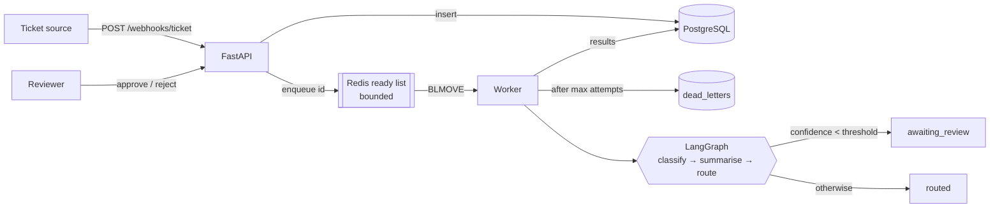

# Flowdesk

Flowdesk takes support tickets from a webhook, uses an LLM (Gemini) to categorise, summarise and route
each one in the background, and sends the ones it isn't sure about to a human for approval.

```bash
cp .env.example .env        # then set LLM_API_KEY to a Gemini API key
docker compose up
```

Open **http://localhost:8000/docs**. Every endpoint can be tried from there. Then run
`scripts/demo.sh` to watch a ticket go from webhook to review to approval.
[docs/GUIDE.md](docs/GUIDE.md) covers everything else.

## Architecture



The API only validates, inserts and enqueues, so a webhook returns `202` in milliseconds no
matter how slow the model is. Everything after the queue runs later in worker processes, and
that part is allowed to fail, retry, back off or give up. When it gives up, the ticket goes to
`dead_letters` where it can be seen and replayed. Tickets the model is unsure about, and every
ticket routed while the provider is down, wait in `awaiting_review` for a person.

## Design decisions and trade-offs

**Queue hand-off: `BLMOVE`, not `BRPOP`.** `BRPOP` deletes a job the moment a worker takes it,
so a worker killed mid-job loses the ticket silently. `BLMOVE` moves the job into that worker's
own processing list instead. Workers keep a heartbeat key alive, and a reaper returns jobs from
any worker whose heartbeat has expired. *Gave up:* exactly-once delivery. Delivery is
at-least-once, so every write downstream has to be idempotent.

**Acknowledge after the work, never on receipt.** Acking on receipt is at-most-once delivery:
faster, but it drops a ticket whenever a worker dies. Losing a support ticket silently is worse
than handling one twice. *Gave up:* a redelivered ticket can occasionally be classified twice,
which costs a duplicate LLM call. The data stays consistent, because classification inserts
use `ON CONFLICT DO NOTHING` and status updates only apply while the ticket is still active.

**Idempotency lives in the database.** `tickets.external_id` is `UNIQUE`, and the webhook does
`INSERT … ON CONFLICT DO NOTHING`. Two concurrent deliveries of the same ticket would both pass
a "check, then insert" test in application code; only one can win the constraint. A repeat
returns the original ticket with `"duplicate": true` and is not re-enqueued.

**Retries with full-jitter exponential backoff.** The delay is
`uniform(0, min(cap, base · 2^attempt))`. Plain exponential backoff makes every client that
failed together retry together, so a recovering provider gets hit by a thundering herd at each
step. The SDK's own retries are turned off so this policy is the only one, and `attempts`
counts what really happened. *Gave up:* a job waits out its backoff in the worker, holding one
concurrency slot for at most `RETRY_MAX_DELAY`. A delayed-retry queue would free the slot, at
the cost of another moving part.

**Errors are sorted before they're retried.** Timeouts, 408, 429 and 5xx are transient: retry
them. Other 4xx responses, blocked prompts and a missing API key are permanent: a 400 will fail the
same way every time, and retrying it burns the whole budget. Those are dead-lettered on the
first attempt. "Is it worth retrying?" and "how long to wait?" are separate decisions.

**Backpressure: `503` with `Retry-After`.** Once the ready queue reaches `QUEUE_MAX_DEPTH`, the
API refuses new tickets rather than accepting them and letting latency grow. Webhook senders
already retry on 5xx, so the backlog waits upstream and overload shows up as a status code
instead of growing Redis memory. Each worker also caps its in-flight jobs with a semaphore, and
only claims a job when it has a free slot, so idle workers get the work. *Gave up:* during a
spike, tickets arrive later instead of all being accepted at once.

**The cache key includes `PROMPT_VERSION`.** Decisions are cached by a hash of the normalised
subject and body. If the prompt version (and model) weren't in the key, changing the prompt
would keep serving decisions the old prompt made, and routing would drift with no obvious
cause. Bump `PROMPT_VERSION` and the old entries stop matching.

**A graph with one place for the threshold.** LangGraph runs `classify → summarise → route`,
with a conditional edge to `escalate` when confidence is below `CONFIDENCE_THRESHOLD`. Cache
hits and rules fallbacks enter the graph at `route`, so nothing reaches `routed` without passing
that check. The routing table is code, not model output, so a ticket can't be talked into a
queue that doesn't exist. *Gave up:* two LLM calls per ticket instead of one, so each prompt
has a single job.

**Graceful degradation.** A circuit breaker opens after `BREAKER_THRESHOLD` consecutive
transient failures. Its state lives in Redis rather than in each process, so N workers share
one view of whether the provider is up and all stop calling it together. While it is open,
tickets are routed by keyword rules with **confidence 0.0**, so every one lands in human review
instead of being silently trusted. After `BREAKER_RESET_SECONDS`, one trial call either closes
the breaker or reopens it.

**Covering the dual write.** The webhook commits to Postgres and then pushes to Redis. If the
API dies between those two steps, the ticket exists but no job does. A sweeper (one worker at a
time, via a Redis lock) re-enqueues tickets left untouched in `queued` or `processing` for 15
minutes. The same sweep rebuilds the queue from Postgres if Redis ever loses data, although
Redis runs with append-only persistence, so a plain restart keeps its jobs. *Gave up:* a
transactional outbox would close the gap immediately, but at the cost of
more machinery than the risk justifies here.

## What's not done

All ten build stages are in. Things I would do next:

- **Signed webhooks.** Replace the shared secret with an HMAC signature over the body plus a
  timestamp, so a leaked header can't be replayed.
- **Delayed retries via a Redis sorted set**, so backoff doesn't hold a worker slot.
- **Observability.** Prometheus metrics for queue depth, attempts, breaker state and cache hit
  rate, plus a trace ID carried from the webhook through the worker.
- **A reviewer audit trail** (who approved what, and when) and authentication on the review
  endpoints.
- **An evaluation set for the prompts**, so a `PROMPT_VERSION` bump is measured against labelled
  tickets before it ships.

## Tests

```bash
docker compose up -d postgres redis
pip install -e '.[dev]' && pytest
```

Tests run against the real Postgres and Redis services, using a separate `flowdesk_test`
database and Redis DB 15. The LLM is faked at the client boundary, not with network mocks.

| Test | Proves |
| --- | --- |
| `test_idempotent_repeat` | Five concurrent deliveries of one `external_id` make one row and one job. |
| `test_retry_then_succeed` | Two transient 503s are retried; the third attempt succeeds (`attempts == 3`). |
| `test_exhausted_retries_dead_letter` | A provider that always fails ends in `dead_letters` with status `failed`, and replay re-queues it. |
| `test_low_confidence_routes_to_review` | Confidence 0.4 lands in `awaiting_review`; approval routes it; a second decision is refused with 409. |
| `test_permanent_error_is_not_retried` | A 400 is dead-lettered on the first attempt, with no retries. |
| `test_crashed_worker_job_is_recovered` | A job claimed by a worker that died is returned by the reaper and processed. |
| `test_full_queue_sheds_load` | Past `QUEUE_MAX_DEPTH` the webhook answers 503 with `Retry-After`. |
| `test_cache_hit_skips_llm_until_prompt_version_changes` | Identical tickets reuse a decision; bumping `PROMPT_VERSION` misses the cache. |
| `test_open_breaker_falls_back_to_rules` | Repeated failures open the shared breaker; tickets go to review via rules, and other workers stop calling the provider. |
| `test_backoff_uses_full_jitter` | Backoff delays spread across the whole range and respect the cap. |
